<div align="center">

# Sistema Multimodal de Recuperación y Búsqueda


Un mini-SGBD escrito **desde cero** en Python que integra, bajo un mismo dialecto SQL,
recuperación por contenido sobre **texto**, **imágenes** y **audio**.


</div>

> **Universidad de Ingeniería y Tecnología (UTEC)** · Base de Datos II — Sección 1
>
> **Integrantes:** Renzo Félix Aponte · Gabriel Frisancho Gálvez · Lisseth Jomely Rondán Cántaro · Alejandro Sebastián Chipayo Flores
> **Docente:** Heider Ysaías Sánchez Enríquez

---

## Tabla de contenidos

1. [Introducción](#1-introducción)
2. [Arquitectura del sistema](#2-arquitectura-del-sistema)
3. [Datasets utilizados](#3-datasets-utilizados)
4. [Detalles de implementación por módulo](#4-detalles-de-implementación-por-módulo)
   - [4.1 Índice invertido para texto](#41-índice-invertido-para-texto)
   - [4.2 Índice invertido para descriptores locales](#42-índice-invertido-para-descriptores-locales)
   - [4.3 Parser SQL y Frontend](#43-parser-sql-y-frontend)
5. [Resultados experimentales](#5-resultados-experimentales)
6. [Análisis de trade-offs y conclusiones](#6-análisis-de-trade-offs-y-conclusiones)
7. [Instalación y uso](#7-instalación-y-uso)
8. [Ejemplos de uso (casos de aplicación)](#8-ejemplos-de-uso-casos-de-aplicación)
9. [Mini-manual de usuario](#9-mini-manual-de-usuario)
10. [Estructura del repositorio](#10-estructura-del-repositorio)

---

## 1. Introducción

### 1.1 Dominio de datos

El sistema trabaja simultáneamente con tres modalidades de datos no estructurados:

| Modalidad | Contenido | Representación interna |
|-----------|-----------|------------------------|
| **Texto** | Letras de canciones y documentos de productos | Índice invertido TF-IDF |
| **Imágenes** | Catálogo de moda (e-commerce) | Bag of Visual Words (SIFT) |
| **Audio** | Fragmentos musicales por género | Bag of Acoustic Words (MFCC) |

### 1.2 El problema: recuperación por contenido

La búsqueda relacional clásica (por clave primaria o por atributo exacto) **no basta**
cuando la pregunta es *"¿qué documentos, imágenes o canciones se parecen a esto?"*.
Una prenda no se busca por su `id`, sino por su apariencia; una canción no se busca por
su nombre, sino por cómo suena o por lo que dice su letra. Esto exige representar el
**contenido** de cada objeto como un vector y medir **similitud**, no igualdad.

### 1.3 Justificación de una base de datos multimodal

Integrar texto, imágenes y audio **bajo un único gestor SQL** evita mantener tres
sistemas separados, permite mezclar filtros relacionales con búsqueda por similitud, y
reutiliza el mismo motor de almacenamiento, catálogo e índices. El usuario expresa todo
—crear tablas, cargar datos, indexar y consultar por similitud— con un **único lenguaje**.

### 1.4 Objetivos

- Construir un **índice invertido en memoria secundaria** (SPIMI) con ranking por **similitud de coseno** para texto.
- Construir un **índice invertido de descriptores locales** (Bag of Visual/Acoustic Words) con búsqueda **KNN** secuencial e indexada.
- Ofrecer un **parser SQL** y una **GUI** que unifiquen la interacción.
- **Experimentar** y comparar contra PostgreSQL (índices B-Tree y GIN).

---

## 2. Arquitectura del sistema

### 2.1 Visión general

El backend es un **gestor de base de datos propio**: no usa ningún motor SQL externo. Se
apoya sobre el **motor relacional del Proyecto 1** (almacenamiento en páginas, registros de
tamaño fijo e índices B+ Tree, Extendible Hashing, R-Tree y Sequential File) y **añade en el
Proyecto 2** la capa de **recuperación por contenido** para texto, imágenes y audio.

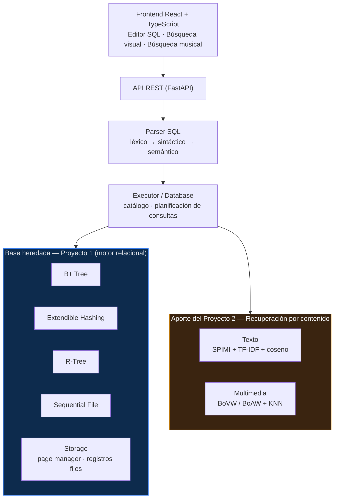

> **Leyenda.** En azul, la **base heredada del Proyecto 1** (motor relacional, almacenamiento
> e índices por clave). En naranja, el **aporte del Proyecto 2**: la recuperación por contenido.
> El parser y el executor son el punto común: una misma consulta SQL puede resolverse por un
> índice relacional (igualdad/rango) o por un índice de contenido (similitud).

Los descriptores crudos se extraen con librerías especializadas (OpenCV para SIFT, librosa
para MFCC), pero **la cuantización, los histogramas, el índice invertido y la búsqueda se
implementan a mano**. Las tres modalidades comparten un mismo patrón: *representar el
contenido como un vector disperso, indexarlo y recuperar por similitud de coseno / KNN*.

### 2.2 Arquitectura del módulo de texto

Un documento se normaliza, se **fragmenta (chunking)** y se indexa con **SPIMI** en memoria
secundaria; la consulta se rankea por **similitud de coseno TF-IDF** y los fragmentos se
re-agregan a su documento padre.

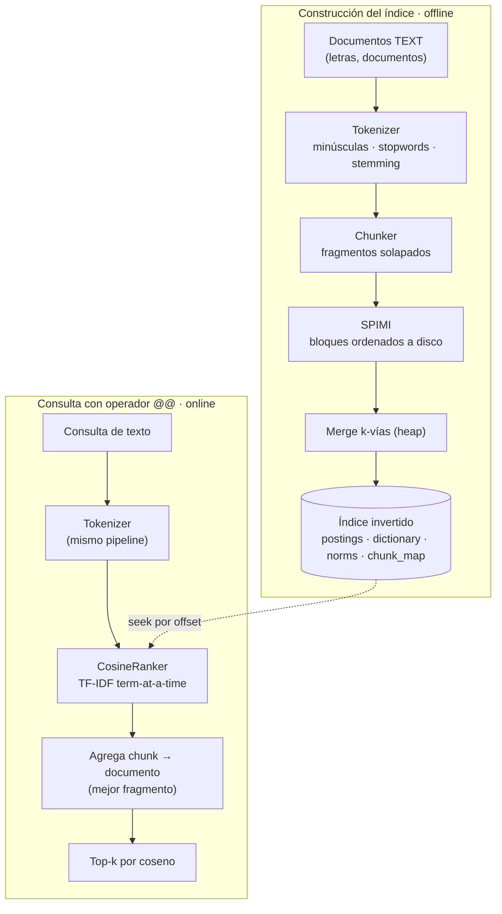

### 2.3 Arquitectura del módulo de imágenes

Cada imagen se describe con **SIFT**; un **K-Means** construye el vocabulario visual
(*codebook*) y cada imagen pasa a un **histograma Bag of Visual Words** ponderado con TF-IDF.
La búsqueda es **KNN por coseno**, en versión secuencial o indexada.

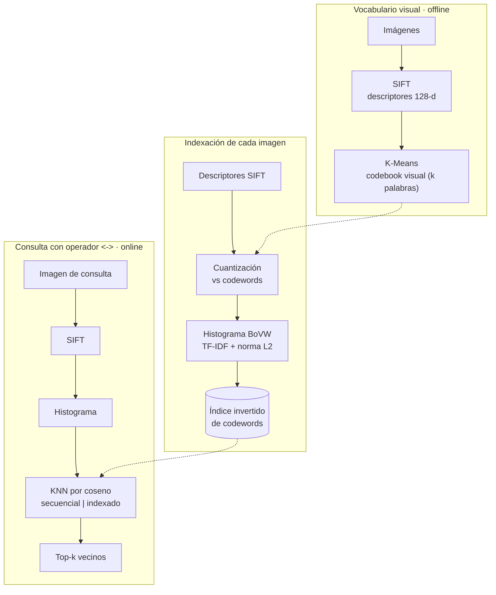

### 2.4 Arquitectura del módulo de audio

Mismo patrón que las imágenes, cambiando el descriptor: cada audio se representa por una
secuencia de vectores **MFCC** (ventana deslizante), se cuantiza contra un **codebook
acústico** y se recupera por **KNN** sobre el **histograma Bag of Acoustic Words**.

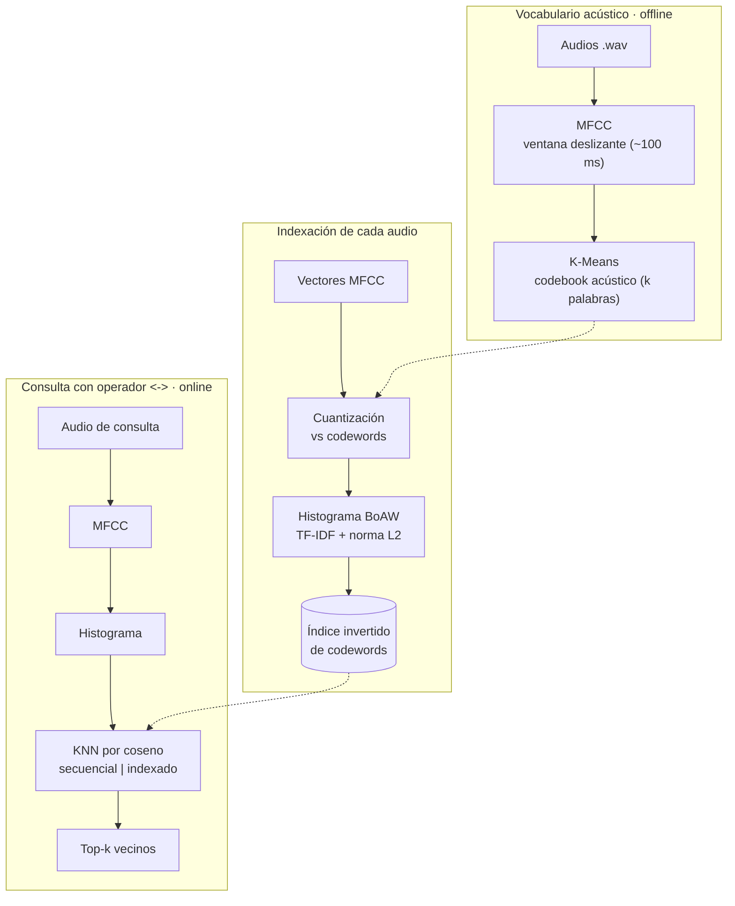

---

## 3. Datasets utilizados

| Dataset | Modalidad | Tamaño | Uso |
|---------|-----------|--------|-----|
| **Fashion E-commerce** | Imágenes `.jpg` + metadatos | 500 productos | Búsqueda visual de moda |
| **GTZAN** | Audio `.wav` | 50 pistas (5 × 10 géneros) | Búsqueda musical por audio |
| **Spotify Songs** | Texto (letras) | `spotify_songs.csv` | Búsqueda musical por letra |
| **Lugares** | Relacional | 1 000 registros | Benchmark relacional vs PostgreSQL |

El dataset de moda incluye columnas `id, name, gender, category, subcategory,
article_type, color, season, usage, image_path`, donde `image_path` se declara como
columna de tipo `IMAGE`.

---

## 4. Detalles de implementación por módulo

### 4.1 Índice invertido para texto

`back/retrieval/text/`

#### Construcción en memoria secundaria (SPIMI)

Se implementa **SPIMI (Single-Pass In-Memory Indexing)** para construir el índice cuando
la colección no cabe en RAM:

1. Se recorren los documentos una vez, acumulando *postings* en bloques.
2. Al llenarse un bloque, se **ordena por término** y se vuelca a disco (`block-*.jsonl`).
3. Se hace un **merge k-vías** con heap de todos los bloques → `postings.jsonl` final.
4. Se calculan `df`, `idf` y las **normas TF-IDF** de cada documento en una segunda pasada.

El **diccionario** (`dictionary.json`) guarda para cada término su `offset` en bytes, de
modo que la consulta hace `seek()` directo al término sin recorrer el archivo.

#### Ranking por similitud de coseno

El `CosineRanker` calcula, *term-at-a-time*, el producto punto entre el vector TF-IDF de
la consulta y el de cada documento, normaliza por `‖q‖·‖d‖` y devuelve el **top-k** con un
heap. El peso usado es `(1 + log tf) · idf`.

#### Fragmentación (chunking)

Para documentos largos (letras completas), cada documento se parte en **fragmentos
solapados** (ventana deslizante sobre los tokens). Cada fragmento se indexa como un
"documento" y, en la consulta, los resultados se **re-agregan al documento padre tomando
su mejor fragmento**. Esto evita que un término relevante presente en un solo pasaje quede
diluido por el resto del texto. El mapeo `chunk → documento` se persiste en `chunk_map.json`.

#### Índices invertidos en PostgreSQL (GIN)

Como comparación nativa se usa el índice **GIN** de PostgreSQL sobre un campo `tsvector`,
consultado con `@@ plainto_tsquery(...)`. PostgreSQL resuelve estas búsquedas con un
**Bitmap Index Scan** sobre el GIN (validado con `EXPLAIN ANALYZE`, ver [§5](#5-resultados-experimentales)).

| Pieza | Archivo |
|-------|---------|
| Tokenizer (normalización, stopwords, stemming) | `tokenizer.py` |
| Fragmentador | `chunker.py` |
| Constructor SPIMI | `spimi.py` |
| Índice invertido en disco | `inverted_index.py` |
| Ranking coseno | `cosine_ranker.py` |
| Orquestador | `text_retriever.py` |

### 4.2 Índice invertido para descriptores locales

`back/retrieval/media/`

#### Bag of Visual / Acoustic Words

El pipeline es el mismo para imágenes y audio, cambiando solo el extractor:

```
Objeto → descriptores locales → cuantización contra codebook → histograma → TF-IDF + norma
```

- **Imágenes:** descriptores **SIFT** (128 dimensiones por keypoint) con OpenCV.
- **Audio:** descriptores **MFCC** por ventana deslizante (~100 ms) con librosa.
- **Codebook (vocabulario visual/acústico):** clustering **K-Means** de todos los
  descriptores → cada centroide es una "palabra".
- **Histograma:** cada objeto se representa por la frecuencia de sus palabras, ponderada
  con **TF-IDF** y normalizada.

#### Técnica de indexación y búsqueda KNN

- **Secuencial:** compara el histograma de consulta contra todos (fuerza bruta, baseline).
- **Indexada:** un **índice invertido de codewords** apunta de cada palabra a los objetos
  que la contienen; solo se re-rankean los candidatos que comparten palabras con la consulta.

Ambas devuelven los `k` vecinos más cercanos con `score` y `ranking`.

#### Maldición de la dimensionalidad y mitigación

A mayor dimensión, las distancias tienden a homogeneizarse. Estrategias aplicadas:

- **Cuantización** de miles de descriptores a un vocabulario finito (histograma compacto).
- **Ponderación TF-IDF** para restar peso a palabras visuales/acústicas muy frecuentes.
- **Límite de keypoints** y **reescalado** de imágenes para acotar costo.
- **Histogramas dispersos** e índice invertido para no comparar contra toda la colección.

| Pieza | Archivo |
|-------|---------|
| Extractor SIFT | `extractors/image_descriptor.py` |
| Extractor MFCC | `extractors/audio_descriptor.py` |
| Codebook (K-Means) | `vocabulary.py` |
| Histograma BoVW/BoAW | `histogram.py` |
| Índice invertido de codewords | `histogram_index.py` |
| KNN secuencial | `sequential_search.py` |

### 4.3 Parser SQL y Frontend

`back/parser/` · `frontend/`

El **parser** (léxico → sintáctico → semántico, descendente recursivo, escrito a mano)
soporta un dialecto que incluye tipos de contenido `TEXT`, `IMAGE`, `AUDIO` y los
operadores de recuperación:

```sql
-- Crear tabla con columna multimedia e índice
CREATE TABLE products (id INT PRIMARY KEY USING BPLUS TREE, name CHAR(80), image_path IMAGE);
CREATE INDEX idx_products_image ON products (image_path) USING MULTIMEDIA;

-- Búsqueda por similitud multimedia  (operador <->)
SELECT * FROM products WHERE image_path <-> 'datasets/query.jpg' LIMIT 10 USING MULTIMEDIA;
SELECT * FROM cancion  WHERE pista <-> 'consulta.wav' LIMIT 10;

-- Búsqueda textual rankeada por coseno  (operador @@)
SELECT * FROM docs WHERE cuerpo @@ 'machine learning' LIMIT 10;
```

El **frontend** (React 18 + TypeScript + Vite + Tailwind) ofrece:

- **Editor SQL** con Monaco y ejemplos precargados.
- Paneles dedicados de **búsqueda visual** (subir imagen) y **búsqueda musical** (subir `.wav`).
- **Tabla de resultados** con `score` y `ranking`, grilla de productos con imágenes, y panel de métricas.

<div align="center">

**Interfaz gráfica — Editor SQL y tabla de resultados**


</div>

---

## 5. Resultados experimentales

La experimentación se organizó en cuatro niveles comparando el **Mini-SGBD propio**
contra **PostgreSQL** y contrastando búsqueda **indexada vs. secuencial**.

### Nivel 1 — Consultas relacionales (Mini-SGBD vs PostgreSQL, carga 1K)

Se cargaron 1 000 registros y se probó búsqueda exacta existente/inexistente y por rango.

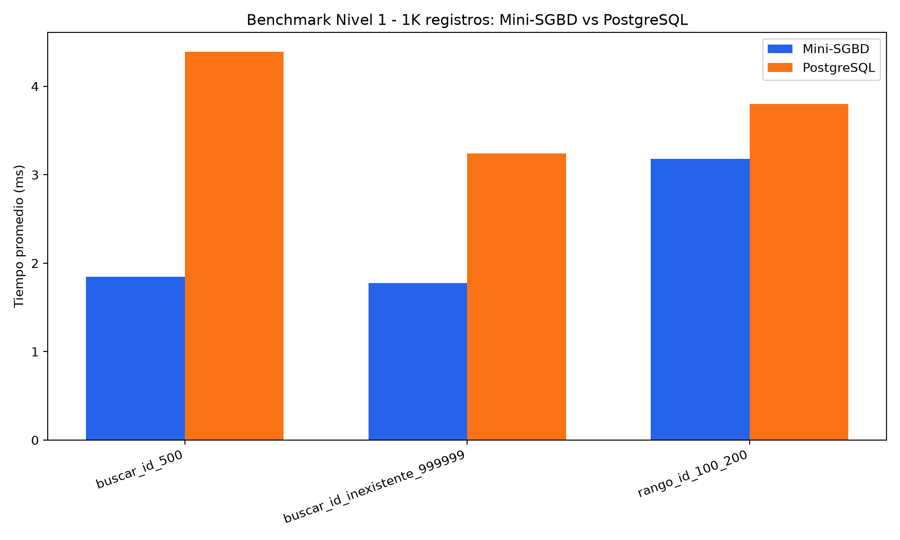

> **Resultado:** el Mini-SGBD obtuvo **menores tiempos promedio** en las tres consultas.
> PostgreSQL logró mejores mínimos y medianas en algunos casos, pero con **máximos más
> altos** que elevaron su promedio general.

<details>
<summary>Salida de consola del benchmark</summary>

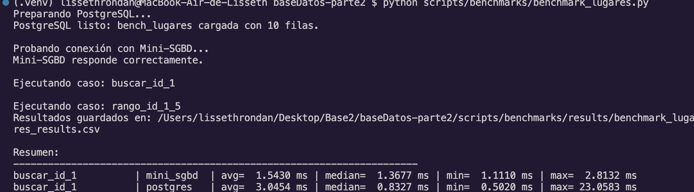

</details>

### Nivel 2 — Búsqueda visual e-commerce (Indexed vs Sequential)

Objetivo: comprobar que el frontend detecta la tabla `products`, la columna `image_path` y el
índice visual, y recuperar los productos más parecidos a una imagen de consulta (Top-10).

#### Caso 1 — Kurta azul estampada

**1) Carga del módulo visual y previsualización de la imagen subida**


**2) Búsqueda visual Top-10 y visualización de resultados**

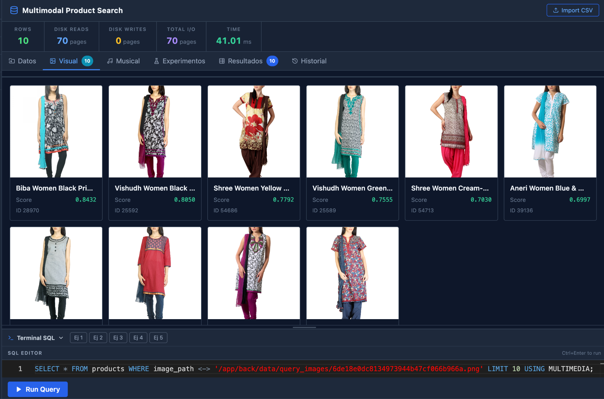

**3) Evaluación cualitativa de precisión**

El sistema retornó 10 productos. La mayoría corresponden a prendas femeninas tipo *kurta set /
salwar suit / churidar kurta*, dentro de la categoría *Apparel Set* y uso *Ethnic*.

| Criterio evaluado | Resultado observado |
|-------------------|---------------------|
| Cantidad de resultados retornados | 10 productos |
| Coincidencia de categoría | **Alta** — prendas femeninas de tipo étnico |
| Coincidencia de tipo de producto | **Alta** — kurta, salwar suit o churidar kurta |
| Coincidencia de color/patrón | **Media** — variaciones de color y diseño |
| **Precisión cualitativa global** | **Media-alta** |

#### Caso 2 — Producto de loción corporal

**1) Carga del módulo visual y previsualización**

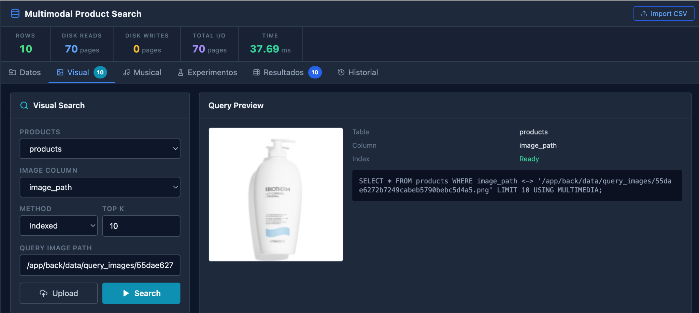

**2) Búsqueda visual Top-10 y resultados**

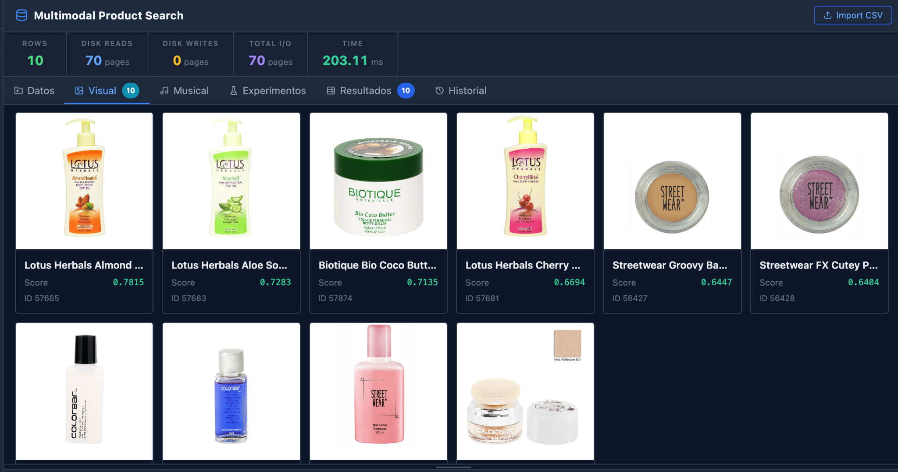

**3) Evaluación cualitativa**

| Criterio evaluado | Resultado observado |
|-------------------|---------------------|
| Cantidad de resultados retornados | 10 productos |
| Coincidencia de categoría | **Alta** — pertenece a *Bath and Body* |
| Coincidencia de tipo de producto | **Media** — 5 productos del mismo tipo |
| Coincidencia de color/patrón | **Media** — 6 productos con variaciones |
| **Precisión cualitativa global** | **Media-alta** |

#### Comparación Indexed vs Sequential (ambos casos)

Misma imagen de consulta, misma tabla y mismo Top-K:

| Caso | Método | Filas | Total I/O | Tiempo |
|------|--------|:-----:|:---------:|:------:|
| Kurta azul | Indexed | 10 | 70 pages | 45.20 ms |
| Kurta azul | Sequential | 10 | 70 pages | **29.77 ms** |
| Loción corporal | Indexed | 10 | 70 pages | 67.52 ms |
| Loción corporal | Sequential | 10 | 70 pages | **48.74 ms** |

> **Observación:** en ambos casos la búsqueda **secuencial** fue más rápida que la indexada
> (≈15.43 ms en la kurta y ≈18.78 ms en la loción). Para este tamaño de dataset, el índice
> multimedia **no** produjo mejora de tiempo frente al recorrido secuencial.

### Nivel 3.1 — Búsqueda musical por audio (GTZAN)

Se insertaron **50 audios** desde GTZAN (5 archivos por cada género musical), copiados al
directorio interno del backend, y se creó el índice multimedia sobre la columna `pista`.

**1) Creación de la tabla musical e inserción de audios**

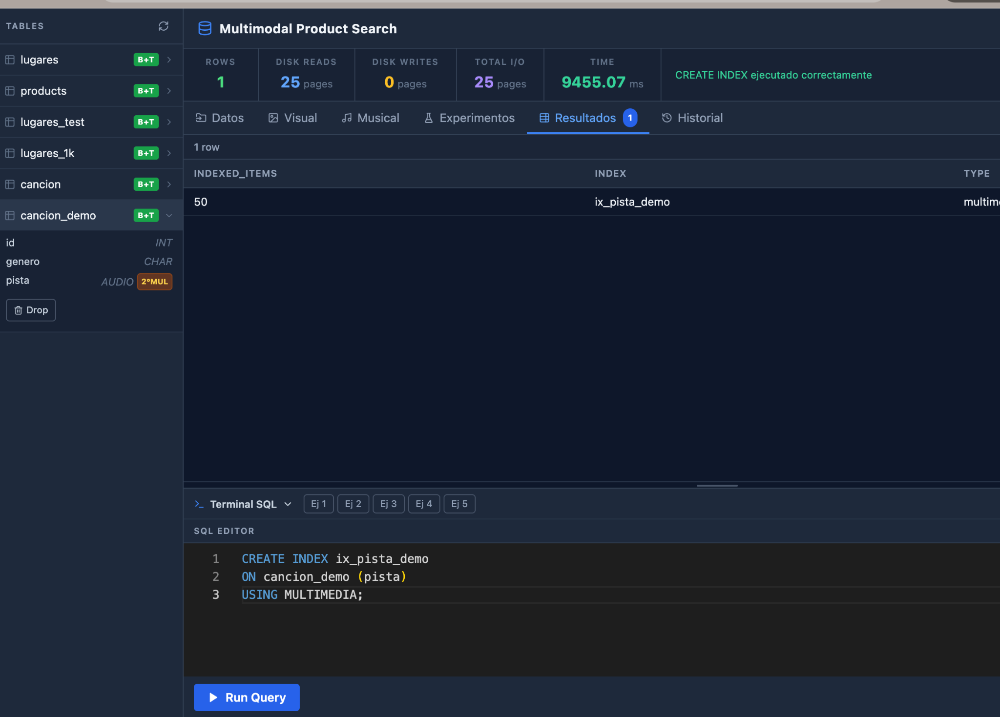

**2) Búsqueda musical mediante consulta SQL**

La consulta retornó **10 audios similares**, mostrando género, pista, `score` y `ranking`.
El primer resultado corresponde al **mismo audio consultado**, con `score = 1`.

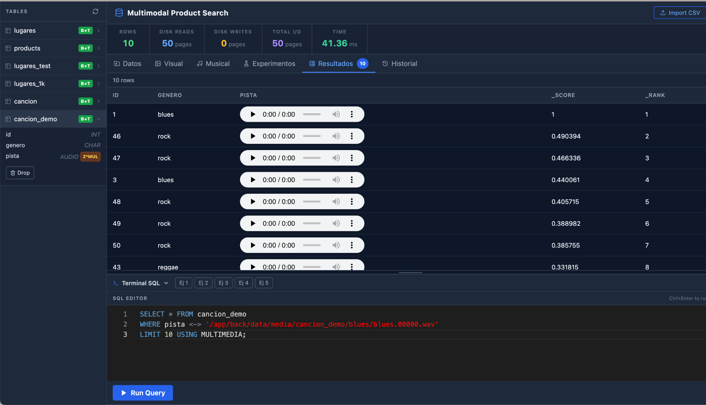

**3) Búsqueda musical mediante subida de audio (frontend)**

También se probó subiendo un archivo `.wav` desde el frontend: el sistema retornó 10
resultados similares en ≈ **50.947 ms**.

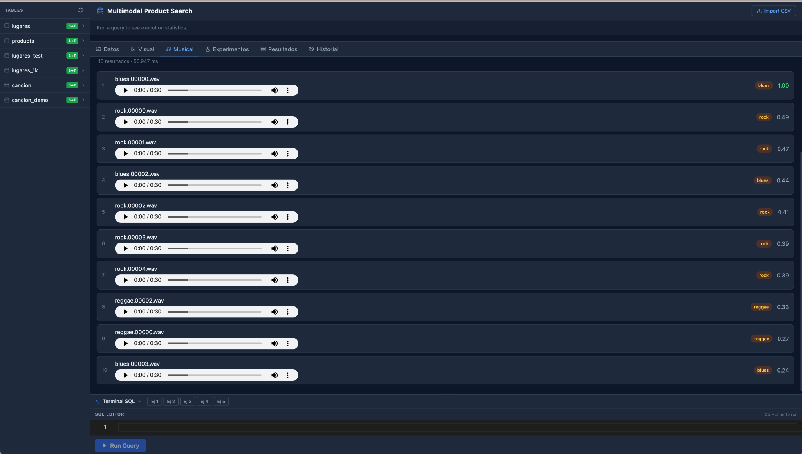

### Nivel 3.2 — Búsqueda musical por letra (Spotify Songs)

Sobre la tabla `Lyrics` (texto) se creó el índice invertido y se ejecutaron búsquedas por
letra tanto por SQL como desde el frontend, validando la recuperación textual sobre canciones.

**1) Creación de la tabla Lyrics** 

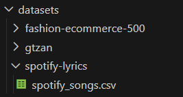
Se cargó el csv en la carpeta datasets.

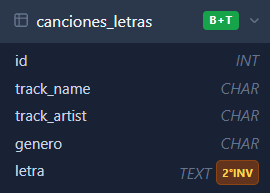
Se creó la tabla canciones_letras en el frontend.

**2) Inserción de lyrics**
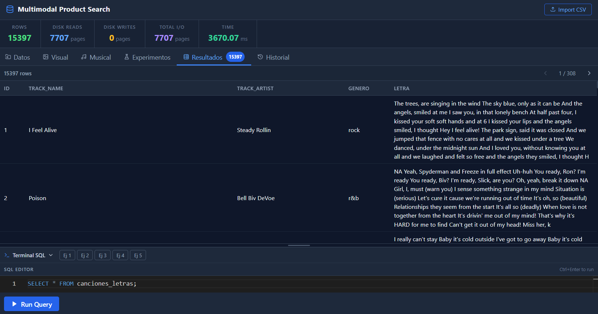
Se insertaron 15397 filas en la tabla desde spotify_songs.csv. Los archivos fueron copiados al directorio interno del backend.

**3) Búsqueda musical mediante consulta SQL**
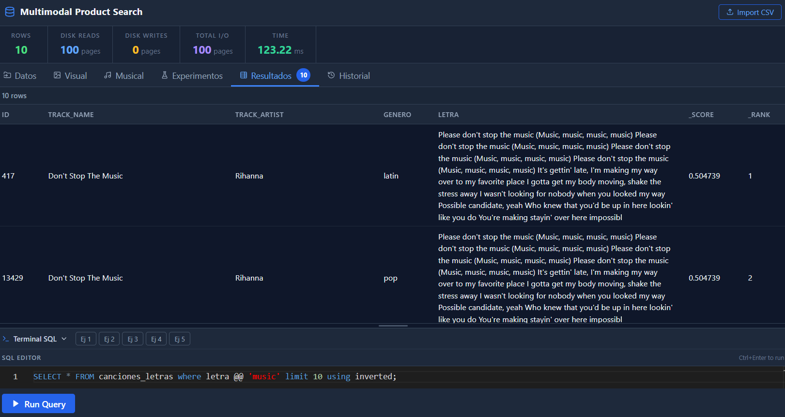
Las 10 canciones más parecidas a la letra “music” usando búsqueda invertida.

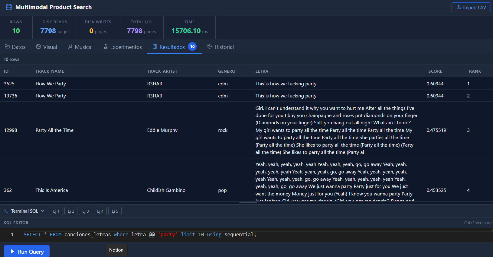
Las 10 canciones más parecidas a la letra “party” usando búsqueda secuencial.


### Nivel 4 — Comparación con PostgreSQL nativo (índice GIN)

Tabla `pg_products_text` con 500 productos; se generó un campo `documento` combinando
nombre, categoría, tipo de artículo, color, temporada y uso. Se evaluaron tres consultas
textuales representativas (`kurta`, `body lotion`, `flip flops`), cada una en múltiples
iteraciones para obtener promedio, mediana, mínimo y máximo.

| Consulta | Motor | Promedio | Mediana | Mínimo | Máximo |
|----------|-------|:--------:|:-------:|:------:|:------:|
| `kurta` | PostgreSQL GIN | 12.5712 ms | 11.6292 ms | 10.2712 ms | 38.6182 ms |
| `body lotion` | PostgreSQL GIN | **1.6433 ms** | 1.6005 ms | 1.4793 ms | 2.4425 ms |
| `flip flops` | PostgreSQL GIN | 13.3936 ms | 13.3390 ms | 12.5556 ms | 16.4296 ms |

`EXPLAIN ANALYZE` confirma que PostgreSQL resolvió la búsqueda con un **Bitmap Index Scan**
sobre el GIN, validando que la búsqueda textual se apoyó en una estructura de índice nativa.
`body lotion` fue la más rápida por tener **menos coincidencias** (mayor selectividad),
mientras `kurta` y `flip flops` recuperaron más candidatos.

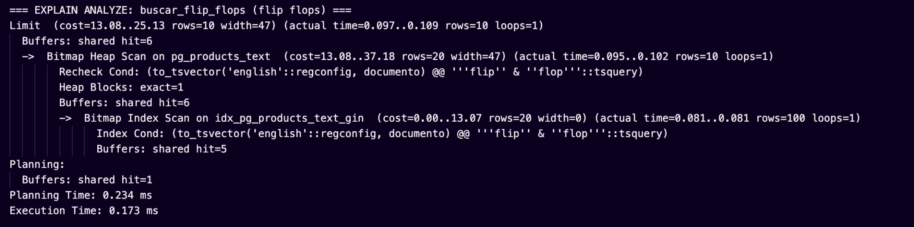

### Nivel 5 — Comparación con PostgreSQL pgvector (44k imágenes)

Para evaluar la modalidad de imágenes a escala completa se construyó una tabla PostgreSQL
con los histogramas visuales de **44 440 productos** y un índice **HNSW** de `pgvector`.
La consulta compara el vector de la imagen de entrada contra la columna `embedding` usando
distancia coseno (`<=>`) y recupera el Top-K de productos visualmente similares.

| Motor | Promedio | Mediana | Dataset | Plan PostgreSQL |
|-------|:--------:|:-------:|:-------:|-----------------|
| Implementación propia indexada | 123.3548 ms | 128.5020 ms | 44 440 imágenes | Índice invertido BoVW |
| Implementación propia secuencial | 234.9355 ms | 249.9540 ms | 44 440 imágenes | Recorrido completo |
| PostgreSQL pgvector HNSW | **4.0777 ms** | **3.9312 ms** | 44 440 imágenes | `Index Scan` sobre HNSW |

El plan de ejecución confirma que PostgreSQL no realizó un recorrido secuencial: usó
`idx_pg_products_image_vectors_cmp_hnsw` para resolver la búsqueda KNN sobre los vectores
de imágenes.

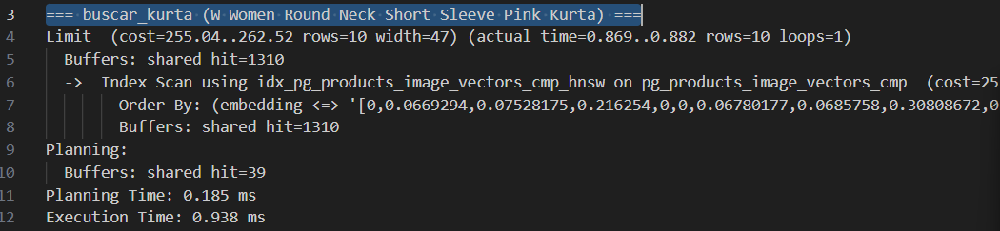

---

## 6. Análisis de trade-offs y conclusiones

- **Indexado vs. secuencial en multimedia:** para colecciones **pequeñas** (500 imágenes /
  50 audios) la búsqueda **secuencial fue más rápida** que la indexada (≈15–19 ms de
  ventaja), porque el sobrecosto de recorrer el índice invertido de codewords y re-rankear
  candidatos no se amortiza. El índice invertido **paga** cuando la colección crece lo
  suficiente como para que evitar comparaciones domine sobre su sobrecosto.
- **Selectividad del término (texto):** el tiempo de una búsqueda textual depende
  fuertemente de cuántos documentos coinciden; términos poco frecuentes se resuelven casi
  instantáneamente.
- **pgvector a escala completa:** con 44k imágenes, PostgreSQL `pgvector` con HNSW resolvió
  las consultas visuales en pocos milisegundos y el plan confirmó `Index Scan`, mostrando
  una mejora clara frente al índice propio y al recorrido secuencial.
- **Mini-SGBD vs PostgreSQL (relacional):** en cargas pequeñas el motor propio fue
  competitivo en promedio; PostgreSQL brilla en consistencia (mínimos/medianas) gracias a
  su madurez, pero mostró picos máximos mayores.
- **Dimensionalidad:** TF-IDF + cuantización + histogramas dispersos son claves para que la
  similitud siga siendo discriminativa.

**Conclusión:** el sistema cumple el objetivo de unificar recuperación por contenido de
texto, imagen y audio bajo un mismo SQL. Los experimentos evidencian que la elección
*indexado vs. secuencial* es un **trade-off dependiente de la escala**, y que la comparación
con PostgreSQL (B-Tree, GIN y pgvector/HNSW) sitúa al motor propio en un marco de referencia
realista.

---

## 7. Instalación y uso

### Opción A — Docker (recomendada)

```bash
docker compose up --build
```

- Frontend: <http://localhost>
- API: <http://localhost:8000>

### Opción B — Local

**Backend**

```bash
pip install -r back/requirements.txt
python run.py            # levanta la API en http://localhost:8000
```

**Frontend**

```bash
cd frontend
npm install
npm run dev              # http://localhost:5173
```

> Requisitos backend: `fastapi`, `uvicorn`, `numpy`, `opencv-contrib-python-headless`,
> `librosa` (ver `back/requirements.txt`).

---

## 8. Ejemplos de uso (casos de aplicación)

Se implementaron **tres aplicaciones** de las Ideas Sugeridas:

### Búsqueda visual de moda (e-commerce)

Subir la foto de una prenda y recuperar los productos visualmente más parecidos del catálogo.

```sql
CREATE TABLE products (id INT PRIMARY KEY USING BPLUS TREE, name CHAR(80), image_path IMAGE);
CREATE INDEX idx_products_image ON products (image_path) USING MULTIMEDIA;
SELECT * FROM products WHERE image_path <-> 'datasets/query.jpg' LIMIT 10 USING MULTIMEDIA;
```

### Búsqueda musical por audio (Shazam-like)

Subir un fragmento `.wav` y encontrar las pistas más similares por su contenido acústico.

```sql
SELECT * FROM cancion WHERE pista <-> 'consulta.wav' LIMIT 10 USING MULTIMEDIA;
```

### Búsqueda de canciones por letra

Buscar canciones por el contenido textual de su letra, rankeadas por similitud de coseno.

```sql
SELECT * FROM lyrics WHERE letra @@ 'never gonna give you up' LIMIT 10;
```

---

## 9. Mini-manual de usuario

1. **Crear una tabla** con una columna de contenido (`TEXT`, `IMAGE` o `AUDIO`) desde el editor SQL.
2. **Cargar datos** con el panel *Data Loader* (importa CSV y asocia rutas de archivos multimedia).
3. **Crear el índice**:
   - Texto → `CREATE INDEX ... USING INVERTED`
   - Imagen/Audio → `CREATE INDEX ... USING MULTIMEDIA`
4. **Consultar por similitud**:
   - Texto → operador `@@`
   - Multimedia → operador `<->` (opcional `USING SEQUENTIAL | MULTIMEDIA`)
5. Revisar los resultados con `score` y `ranking` en la tabla, o usar los paneles
   **Visual** / **Music** para subir el archivo de consulta directamente.

---

## 10. Estructura del repositorio

```
baseDatos-parte2/
├── back/
│   ├── api/            # API FastAPI
│   ├── engine/         # Database, executor, table (motor SQL)
│   ├── parser/         # Léxico, sintáctico, semántico
│   ├── indexes/        # Motor relacional (base Proyecto 1): B+ Tree, Ext. Hashing, R-Tree, Sequential File
│   ├── retrieval/
│   │   ├── text/       # SPIMI, TF-IDF, coseno, chunking
│   │   └── media/      # SIFT/MFCC, BoVW/BoAW, KNN
│   ├── storage/        # Page manager, schema, registros de tamaño fijo
│   ├── experiments/    # Benchmarks y gráficos
│   └── data/           # Índices y datos persistidos
├── frontend/           # GUI React + TypeScript + Vite + Tailwind
├── datasets/           # Fashion e-commerce, Spotify lyrics, GTZAN
├── scripts/benchmarks/ # Benchmarks relacionales y PostgreSQL GIN
└── docker-compose.yml
```

<div align="center">


</div>
